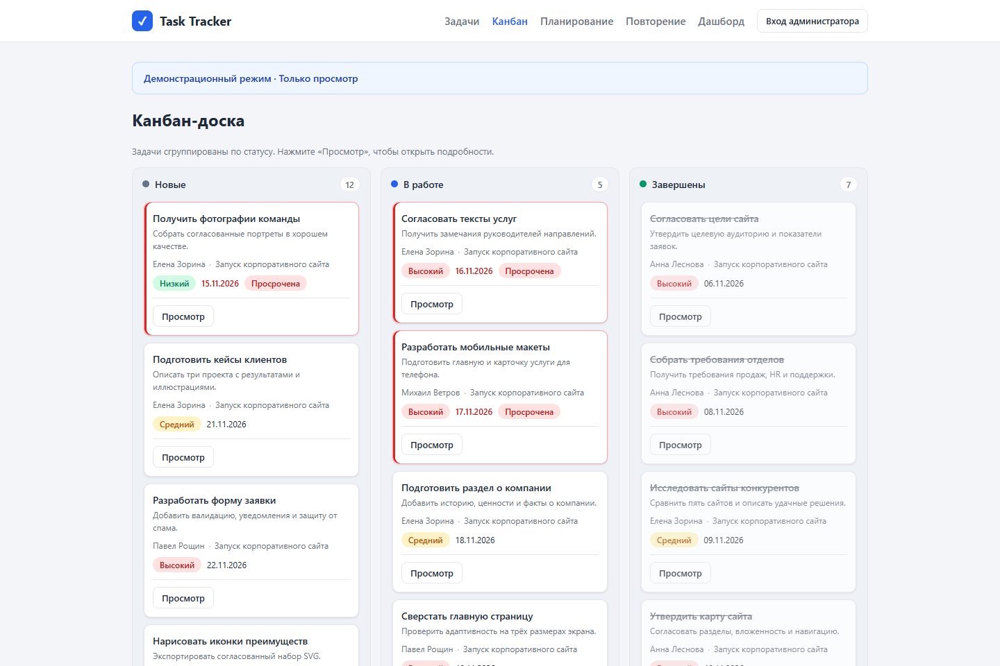
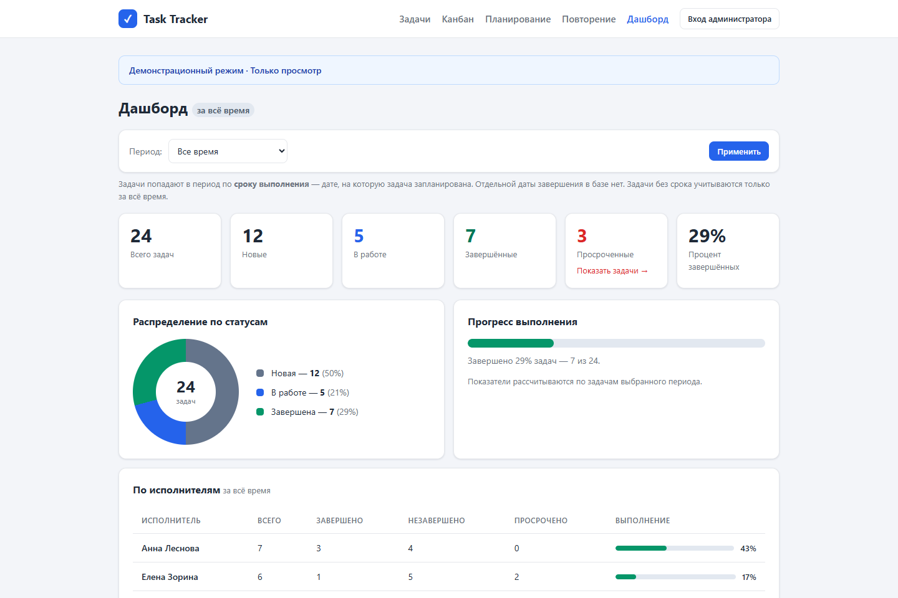
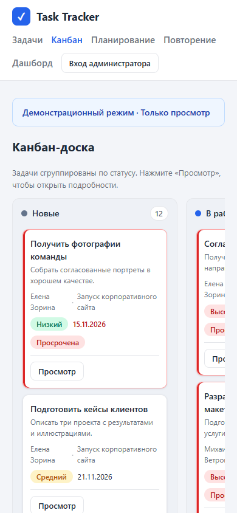

<!-- portfolio-case:v1 -->
# Task Tracker — задачи команды

Список с фильтрами, канбан с переносом карточек, планирование на день и неделю, повторяющиеся задачи и отчёты.

[Все проекты](https://github.com/gek-finn)

## Задача

Собрать задачи, сроки и ответственность в одном месте, чтобы видеть загрузку и просрочку.

## Что реализовано

- Поиск и фильтры по проекту, исполнителю, сроку и приоритету.
- Канбан с Drag & Drop и просмотр задачи в модальном окне.
- Планирование на день и неделю.
- Автоматическое создание повторяющихся задач.
- Отчёты, CSV / Excel и резервное копирование.

## Технологии

Python · Flask · SQLite · HTML / CSS · JavaScript · openpyxl

## Статус и ограничения

Учебный проект. Полноценные отдельные учётные записи и роли участников команды не реализованы. Демонстрация использует вымышленные задачи.

## Интерфейс

Мобильный экран и другие разделы

## Запуск

[Инструкция установки и запуска](docs/SETUP.md).

## О кейсе

Описание показывает реализованные функции. Подтверждённые показатели продаж, экономии времени и коммерческого внедрения в этом кейсе не заявляются.
